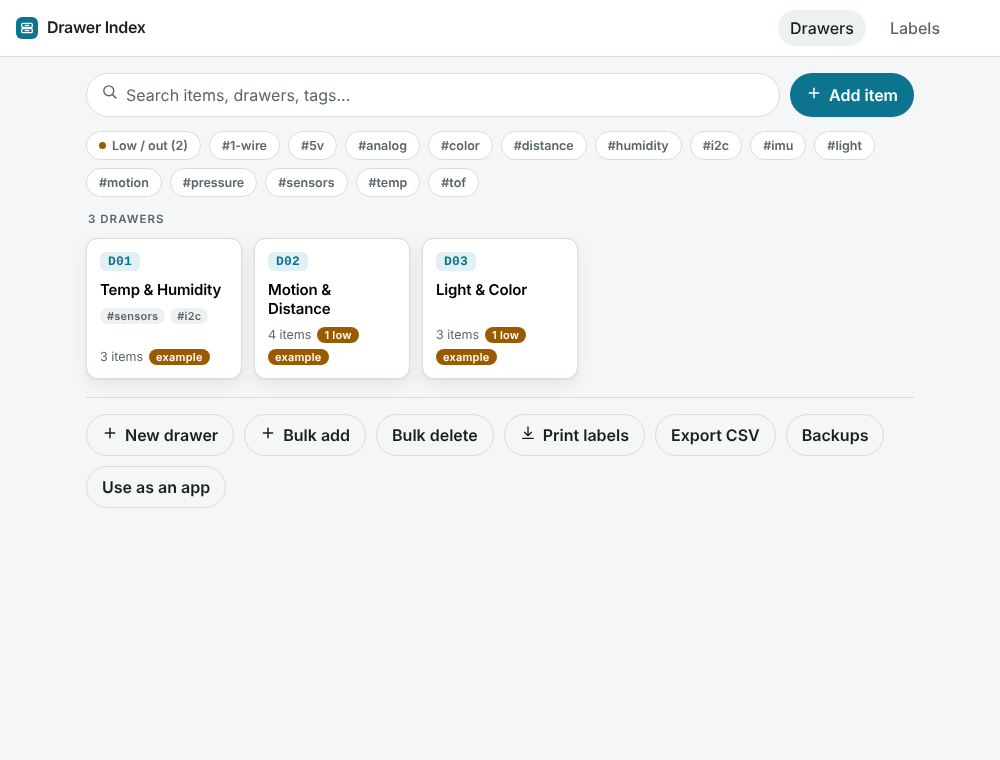
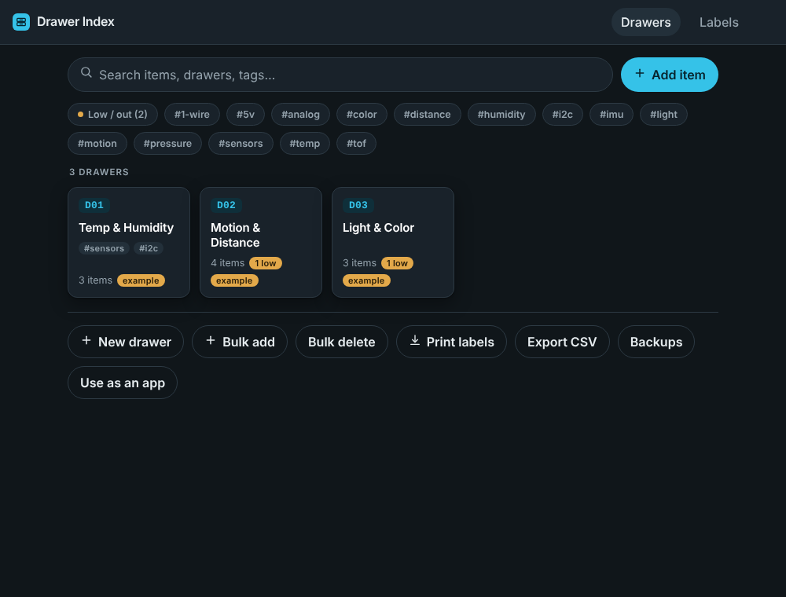
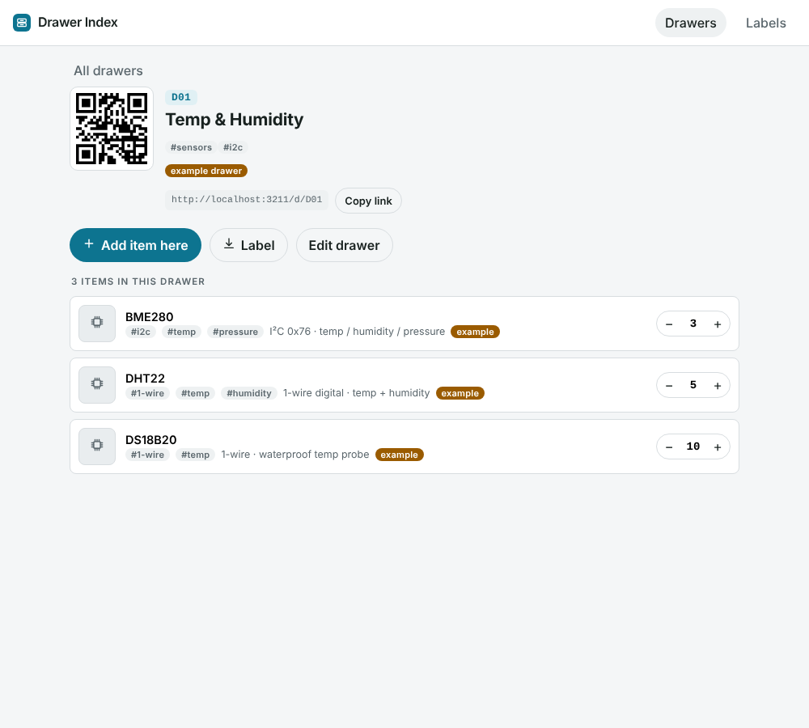
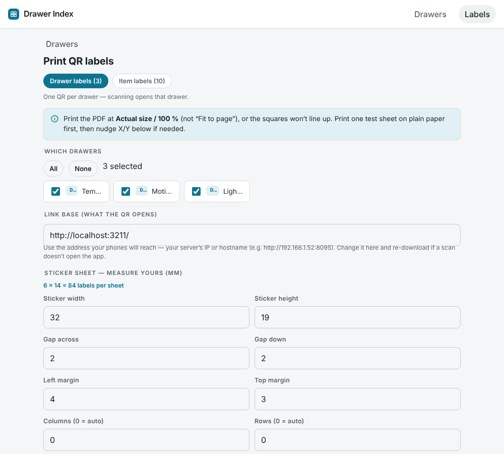
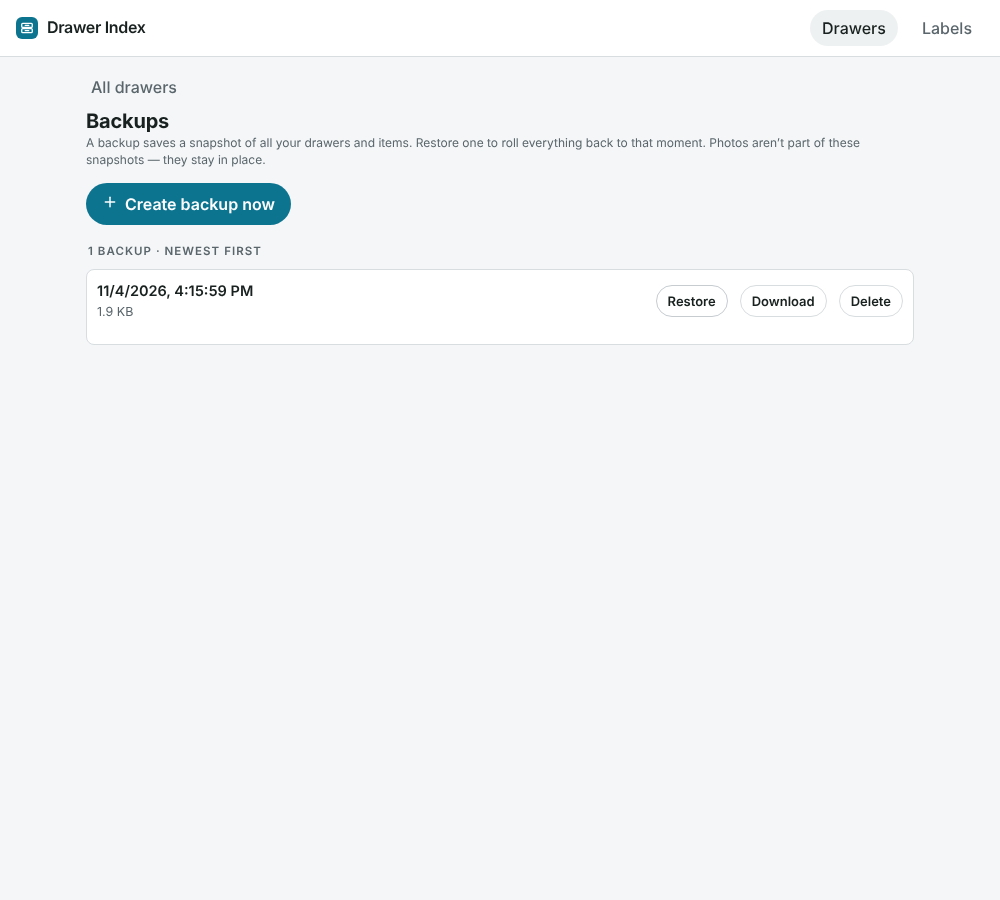

# Drawer Index

A self-hosted **QR-code inventory** for physical storage — drawers, bins, and boxes full of electronics parts, tools, or anything else. Stick a QR label on each drawer, scan it with any phone camera, and see (or edit) what's inside. Search across everything, tag it, track quantities, attach photos, and print label sheets sized to your exact sticker stock.

No account, no cloud, no tracking. Your data lives in one folder you control.

| Light | Dark |
|---|---|
|  |  |

## Features

- **QR labels for drawers and items** — scan a drawer to open its contents, or an individual item to jump straight to it. Any phone camera works; no scanner app.
- **A4 label editor** — measure your real sticker sheet (width, height, gaps, margins) and the preview lines up exactly. Tap individual squares to skip already-used stickers. Exports a print-ready PDF.
- **Items of any kind** — sensors, tools, components, boxes. Names, quantities (± steppers), notes, and optional photos.
- **Tags on items *and* drawers** — free-form, with tap-to-reuse suggestions. Search or filter by tag across both.
- **Bulk add / delete** — generate ranges of drawers at once (`A1…D6`, `1…99`, letters or numbers) with tags applied on creation; delete by range or tag with a clear preview.
- **Low-stock flags** — set a threshold per item; the app flags "low" / "out" and counts them per drawer.
- **Backups & restore** — one-tap dated snapshots; roll everything back to any point (with an automatic safety snapshot before each restore).
- **CSV export** of the whole inventory.
- **Light & dark theme** — follows your system by default, with a manual toggle in the header.
- **Optional password login** — off by default; set one env var to put a sign-in screen in front of everything.
- **Installable** — add it to a phone home screen or desktop as an app (PWA).
- **Live sync** — multiple devices on the same server stay in sync.

| Drawer view | Label editor | Backups |
|---|---|---|
|  |  |  |

## Run it

Pick whichever fits you. Your data always lives in a `data/` folder (Docker/Node) or `drawer-index-data/` folder (exe) that you can copy to back up.

### Docker (recommended)

```bash
git clone https://github.com/gilight123/drawer-index.git
cd drawer-index
docker compose up -d --build
```

Open `http://<server-ip>:8095` (the compose file maps host port `8095` → container `3000`; change it there if you like).

### Node.js (18+)

```bash
npm install --omit=dev
DATA_DIR=./data PORT=8095 npm start
```

### Windows — portable .exe

Grab `DrawerIndex.exe` from the [Releases](https://github.com/gilight123/drawer-index/releases) page, double-click it, and your browser opens to the app. Data is saved in a `drawer-index-data` folder next to the .exe. No install, no Node, no Docker.

## Printing labels

1. Open **Labels**, set **Link base** to the address your phones will reach (e.g. `http://192.168.1.50:8095`) — this is encoded into every QR.
2. Enter your sticker sheet's real measurements (one sticker + the gaps + the margins). The preview must line up with your die-cut stickers.
3. Download the PDF and print at **Actual size / 100 %** (not "Fit to page"). Test on plain paper first.

## Data & backups

- **Docker/Node:** everything is in `data/` (`db.json`, `uploads/`, `backups/`). Back up by copying that folder.
- **exe:** everything is in `drawer-index-data/` next to the executable.
- The in-app **Backups** screen makes dated snapshots of your inventory (photos stay in `uploads/`).

## Configuration

All optional, set as environment variables:

| Variable | Default | What it does |
|---|---|---|
| `PORT` | `3000` (Docker), `8095` (exe) | Port the server listens on |
| `DATA_DIR` | `/data` (Docker), folder next to the exe | Where `db.json`, `uploads/`, `backups/` live |
| `AUTH_PASSWORD` | *(unset)* | If set, requires this password to sign in |

Example (Docker Compose): add under the service:

```yaml
    environment:
      - AUTH_PASSWORD=your-password-here
```

## Security

By default there is **no authentication** — anyone who can reach the port can read and edit. That's fine on a home LAN or a private VPN (e.g. Tailscale).

- To add a **password**, set `AUTH_PASSWORD` (see Configuration). A sign-in screen then gates all data; the session is a signed, HTTP-only cookie.
- Even with a password, **don't expose it to the raw public internet over plain HTTP.** For public access put it behind a reverse proxy (Caddy, nginx, Traefik) that adds **HTTPS** — the login cookie should only travel over TLS.

## Architecture

Deliberately small and framework-free, so it's easy to read and change.

**Backend — `server.js`** (~250 lines, Express only)
- Storage is a single JSON file: `db.json` is read into memory on boot and written atomically on every change (temp file + rename). No database engine.
- Photos are raw files in `uploads/`; backups are timestamped copies of `db.json` in `backups/`.
- Data shape:
  ```js
  { drawers: { "A1": { name, note, order, example, tags: [] } },
    parts:   { "p-xxx": { name, qty, note, drawerId, img, min, tags: [], example } } }
  ```
- REST API (all JSON): `GET /api/state`, `PUT|DELETE /api/drawers/:id`, `PUT|PATCH|DELETE /api/parts/:id`, `POST /api/upload`, `GET|POST|DELETE /api/backups…`, `POST /api/restore`, and `…/api/auth|login|logout`. The header comment in `server.js` lists them all.

**Frontend — `public/index.html`** (one file, vanilla JS, no build step)
- A tiny `h()` DOM builder instead of a framework.
- State lives in one `S` object; the data layer is plain `fetch` calls to the API, with a 5-second poll so multiple devices stay in sync.
- Routing is hash-based: `#` (browse), `#print` (labels), `#backups`, `#<drawerCode>` (a drawer), `#s:<id>` (an item). Scanned QR codes arrive as real paths (`/d/..`, `/s/..`) and are rewritten to those hashes on load.
- The label engine (`cellRect` / `cellSequence` / `drawPreview` / `makePDF`) turns the measured sheet settings into an on-screen preview and a print-ready PDF with jsPDF.
- Theme is pure CSS custom properties; `data-theme` on `<html>` flips light/dark.

To change something, edit the file and reload — there's no compile step.

## Build the Windows .exe yourself

```bash
npm install
npm run build:win     # outputs dist/DrawerIndex.exe
```

Releases are also built automatically by GitHub Actions when you push a `v*` tag (see `.github/workflows/release.yml`).

## Tech

Plain Node.js + [Express](https://expressjs.com/), a single-file vanilla-JS front end (no framework/build step), JSON-file storage, [qrcode-generator](https://github.com/kazuhikoarase/qrcode-generator) and [jsPDF](https://github.com/parallax/jsPDF) vendored locally. Packaged for Windows with [@yao-pkg/pkg](https://github.com/yao-pkg/pkg).

## Contributing

Issues and PRs welcome — see [CONTRIBUTING.md](CONTRIBUTING.md).

## Contact

Questions or suggestions? Open an [issue](https://github.com/gilight123/drawer-index/issues) or email **hilazonmozar@gmail.com**.

## License

[MIT](LICENSE) © 2026 gilight123
